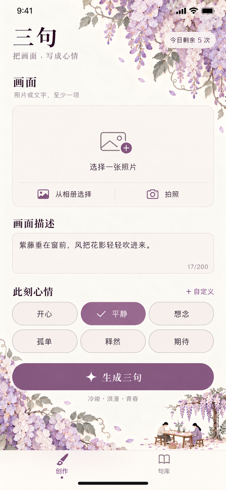
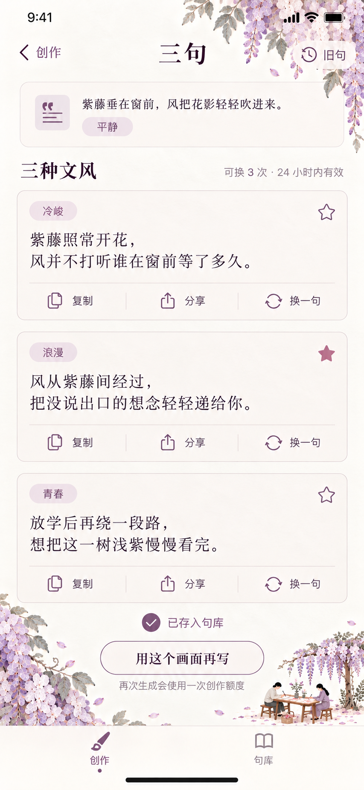
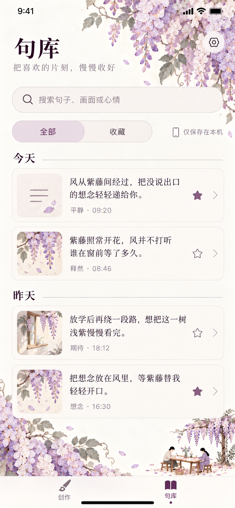

# 三句紫藤纸景设计

确认日期：2026-10-22。产品所有者已确认采用紫藤花系列的纸感视觉，覆盖创作、生成结果和句库三个主页面。

本目录提供三页 PNG 设计稿和完整生成提示词，供后续原生开发使用。当前可运行客户端仍为原生极简版，紫藤风格的 SwiftUI 接入、深色和大字号适配尚待完成。正确工程为 `native/Sanju.xcodeproj`，开发与发布要求见 [原生说明](../../README.md)及 [上架交接说明](../../../deliverables/sanju2.0上架交接说明.md)。

## 三页设计预览

| [创作页](sanju-wisteria-creation-v1.png) | [结果页](sanju-wisteria-result-v1.png) | [句库](sanju-wisteria-library-v1.png) |
| --- | --- | --- |
|  |  |  |

| 文件 | 尺寸 | 页面内容 |
| --- | --- | --- |
| `sanju-wisteria-creation-v1.png` | 852 × 1846 px | 相册和拍照、画面描述、心情选择及自定义、额度提示、生成按钮 |
| `sanju-wisteria-result-v1.png` | 853 × 1844 px | 素材摘要、三种文风、复制、分享、换句、星标收藏、旧句入口与再创作 |
| `sanju-wisteria-library-v1.png` | 853 × 1844 px | 搜索、全部和收藏筛选、今天和昨天分组、缩略图、心情和时间、详情入口 |
| [完整提示词集](sanju-wisteria-series-v1.prompts.txt) | 文本 | 创作页、结果页和句库各自的 imagegen 提示词 |

三张 PNG 均为不透明底。像素尺寸用于设计预览；原生布局按设备尺寸、系统安全区和动态字号适配。

## 已确认的视觉方向

- 以暖白、象牙白为底，藤紫、浅紫和灰藕紫为主色，少量浅杏调和；按钮和选中状态使用较深的柔和藤紫。
- 花藤以垂坠的紫藤花序、细藤和灰绿叶片表现。薄手工纸的形状构成景物，可见长纤维、纸浆碎屑、少量植物碎屑和撕裂毛边，叠层仅有轻微阴影。
- 纸景集中在右上和左下，保留中央连贯的暖白阅读与操作空间；微型人物和桌案置于边缘留白，避开按钮与文字。
- 句子保持宋体阅读气质，操作文字重视清晰度；卡片、输入框、胶囊和线性图标统一为轻量样式。收藏继续使用星标，实装时统一各页面的选中颜色和状态。
- 创作与句库保留两个主标签；结果页属于创作流程。

## 原生接入要点

将花藤、纸纹和微型人物制作成独立装饰素材，输入框、句子、按钮、搜索和导航使用可交互的 SwiftUI 组件。设计图中的状态栏、时间、剩余次数、字数和句子均为示例，实装后读取系统状态与真实数据。

现有业务规则继续沿用：照片或画面描述至少一项，心情必选；描述最多 200 字，心情最多 30 字；每位测试者每天 5 次创作，每份创作共享 3 次换句、24 小时有效。创作图中的文字为 17 字，心情选择「平静」；句库样例和相对日期用于展示排版。

页面改版时保留草稿、收藏及旧句、结果恢复、保存失败和额度处理。详情、旧句、设置、隐私同意、邀请，以及加载、失败、空状态尚无本系列独立设计稿，后续沿用现有交互并统一视觉。深色、大字号、窄屏和键盘出现时的布局需继续验收。

继续沿用异步持久化、350 毫秒草稿合并保存和后台图片缓存。装饰素材在资源层预处理，避免在主线程读文件或在 `View.body` 中重复解码。

## 设计来源

本系列使用内置 imagegen 生成，由产品所有者提供的纸感海报方向逐步形成，并以紫藤创作页作为结果页和句库的风格参考。图中句子与插图用于设计示例；实际服务生成内容由既有后端负责。
